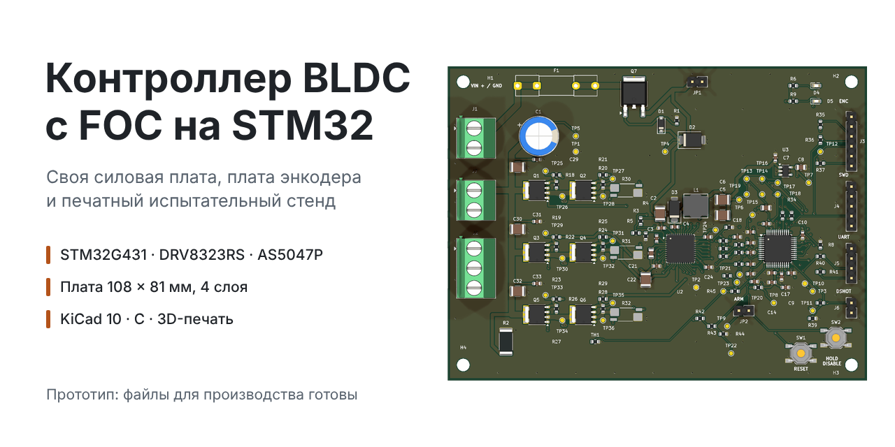
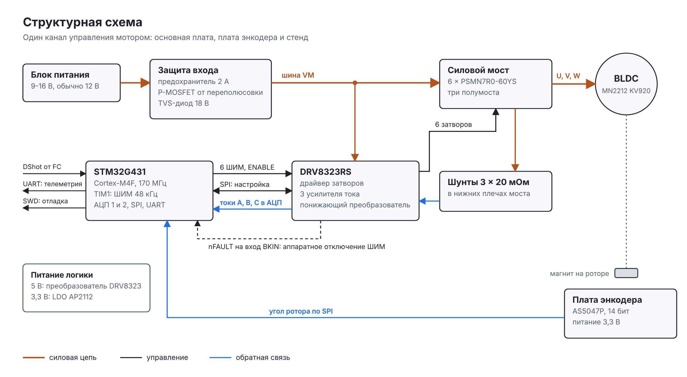
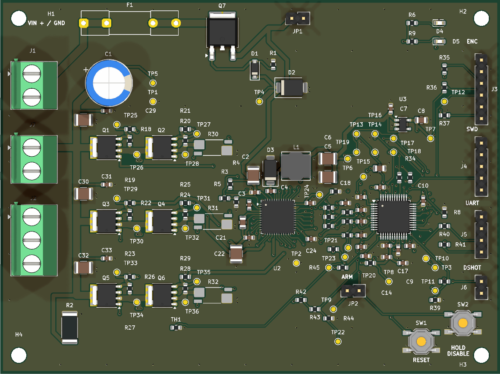
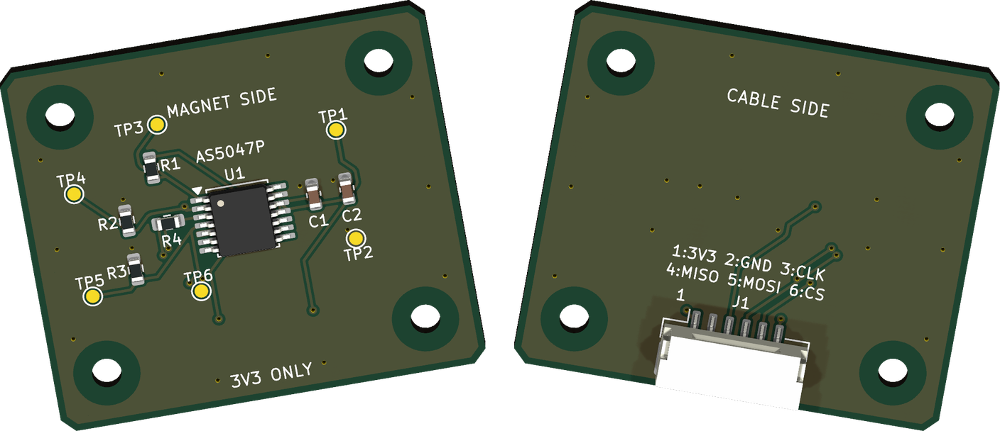
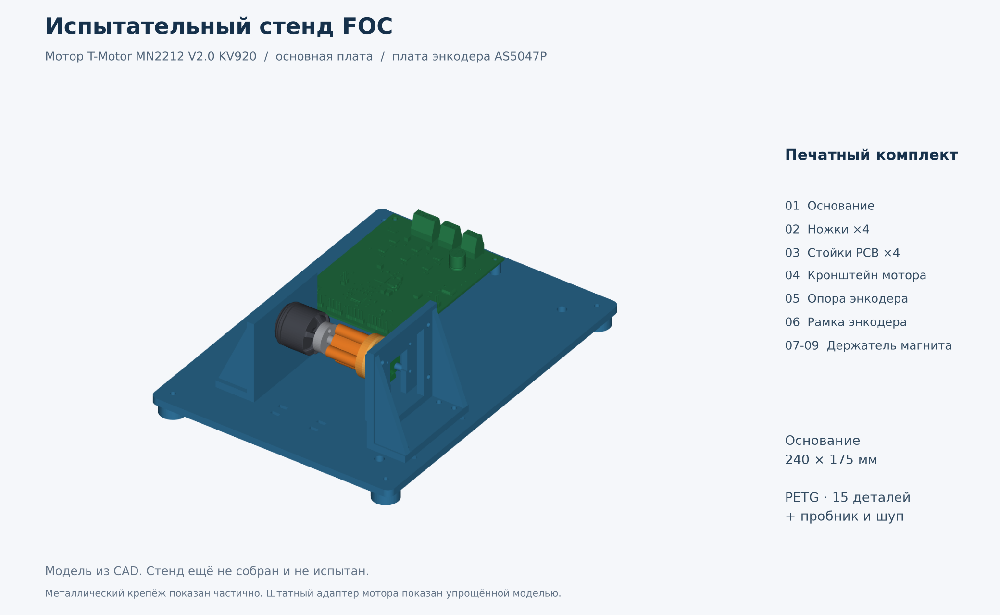

<p align="center">
  
</p>

# Контроллер BLDC с FOC на STM32

[](https://github.com/dganin-hw/bldc-foc/actions/workflows/ci.yml)

**Своя силовая плата, плата магнитного энкодера и печатный стенд. Дальше тот же канал
ляжет в основу четырёхканального ESC для квадрокоптера.**

[Основная плата](hardware/dev-board/README.md) ·
[Плата энкодера](hardware/encoder-board/README.md) ·
[Стенд](hardware/stand/README.md) ·
[Прошивка](firmware/README.md) ·
[4-in-1 ESC](hardware/esc-4in1/README.md) ·
[Теория FOC](docs/foc-theory.md)

Делаю управление бесщёточным мотором целиком: силовую часть, измерение токов, угол
ротора и векторное управление (FOC). Сначала стенд на один мотор. Когда измерения
сойдутся с расчётом, тот же канал перейдёт в 4-in-1 ESC.

**Сейчас:** обе платы разведены, файлы для производства и перечни компонентов готовы,
механика стенда готова к печати. В прошивке каркас, параметры и тесты. На реальном
моторе ещё не запускал.

## Что готово

| Часть | Что это | Состояние |
|---|---|---|
| [Основная плата](hardware/dev-board/README.md) | STM32G431, DRV8323RS, трёхфазный мост, три шунта, питание и интерфейсы. 108 × 81 мм, 4 слоя | схема, разводка, файлы для производства |
| [Плата энкодера](hardware/encoder-board/README.md) | AS5047P, SPI, питание 3,3 В. 32 × 28 мм, 2 слоя | схема, разводка, файлы для производства |
| [Стенд](hardware/stand/README.md) | основание, крепления плат и мотора, регулируемая опора энкодера, держатель магнита | STL, STEP и инструкция, ещё не напечатан |
| [Прошивка](firmware/README.md) | библиотека на C, конфигурация ШИМ, параметры моторов, тесты | каркас, FOC ещё не написан |
| [4-in-1 ESC](hardware/esc-4in1/README.md) | схема на два STM32G474, распределение выводов, проверка размещения | черновик, не для производства |

Проверки ERC и DRC в KiCad 10 проходят без ошибок на обеих платах. Это проверка
файлов: ток, нагрев и защиты проверяются на собранном стенде.

## Как устроено



Угол ротора приходит с платы энкодера по SPI, токи фаз снимаются с шунтов через
усилители DRV8323. FOC переводит токи в координаты ротора, регулирует их и выдаёт
скважности ШИМ. Драйвер открывает шесть MOSFET трёх полумостов. Авария драйвера
(nFAULT) заведена на вход BKIN таймера и выключает ШИМ аппаратно.

Быстрый цикл привязан к ШИМ 48 кГц и запуску АЦП от того же таймера. Команды и
телеметрия идут вне этого цикла. Энкодер нужен на первых запусках и как эталон, когда
дойдёт до оценки угла без датчика.

Питание стенда 9-16 В, обычно 12 В. На первых включениях ток фазы ограничен 1 А:
этот предел держат прошивка и блок питания, а не плата.

## Основная плата



Четыре слоя: микроконтроллер, драйвер, мост, три канала измерения тока и питание
логики. На плате 36 контрольных площадок: на каждый затвор и исток, ШИМ, токи,
питание. Силовая часть отделена перемычкой, поэтому плату можно запускать по шагам.

[Описание](hardware/dev-board/README.md) ·
[Сборка и первое включение](hardware/dev-board/bring-up.md) ·
[Схема PDF](hardware/dev-board/documentation/SCHEMATIC.pdf) ·
[Файлы для производства](hardware/dev-board/manufacturing/README.md) ·
[CubeMX](hardware/dev-board/cubemx/CubeMX.ioc)

## Плата энкодера

<p align="center">
  
</p>

Отдельная маленькая плата, чтобы выставить датчик по оси магнита и подобрать зазор.
Магнит вращается вместе с ротором, плата неподвижна. К основной плате подключается
шестиконтактным кабелем.

[Описание](hardware/encoder-board/README.md) ·
[Схема PDF](hardware/encoder-board/documentation/SCHEMATIC.pdf) ·
[Файлы для производства](hardware/encoder-board/manufacturing/README.md)

## Стенд



Печать из PETG: 11 моделей STL, общая сборка в STEP, пробник посадок, щуп для зазора
и перечень крепежа. Мотор T-Motor MN2212 V2.0 KV920, работа без пропеллера.

[Описание и печать](hardware/stand/README.md) ·
[Сборка и крепёж](hardware/stand/assembly.md) ·
[Лист деталей PDF](hardware/stand/print-layout.pdf)

## Основные компоненты

| Компонент | Зачем |
|---|---|
| STM32G431CBT6 | Cortex-M4F 170 МГц, таймер TIM1 с dead-time и аварийным входом, два АЦП с запуском от таймера |
| DRV8323RSRGZT | драйвер шести затворов, три усилителя тока, диагностика по SPI, свой понижающий преобразователь |
| 6 × PSMN7R0-60YS,115 | N-MOSFET моста, 60 В, корпус LFPAK56 |
| 3 × WSK2512R0200FEA | шунты 20 мОм с отдельными измерительными выводами |
| AS5047P-ATSM | магнитный энкодер, 14 бит, на отдельной плате |
| AP2112K-3.3TRG1 | 3,3 В для логики |
| SRN6045TA-330M и SS16 | дроссель и диод понижающего преобразователя |
| IRFR5305TRPBF | защита входа от переполюсовки |
| SMBJ18A | TVS-диод от коротких выбросов. Энергию торможения он не поглощает |
| NCP18XH103F03RB | термистор, температура платы |
| Eaton BK1/S501-2-R | предохранитель 2 А на входе. Мост он не защищает |

Полный перечень с артикулами и кодами LCSC: [основная плата](hardware/dev-board/manufacturing/bom/BOM.csv),
[плата энкодера](hardware/encoder-board/manufacturing/bom/BOM.csv).

## Прошивка

Пишу на C99. Математика FOC отделена от регистров, поэтому один и тот же код
собирается на ПК для тестов и кросс-компилятором под Cortex-M4F. В GitHub Actions на
каждый push запускаются тесты на ПК и сборка под ARM.

Нужны CMake 3.20 или новее и компилятор C. Из корня репозитория:

```sh
cmake -S firmware -B build -DCMAKE_BUILD_TYPE=Debug
cmake --build build --parallel
ctest --test-dir build --output-on-failure
```

Сейчас готовы вспомогательные функции, конфигурация ШИМ, параметры моторов и тесты.
Преобразования Кларка и Парка, PI-регуляторы, модулятор, модель мотора, драйверы и
наблюдатель на очереди.

[Подробнее о прошивке](firmware/README.md) ·
[Архитектура прошивки](docs/firmware-architecture.md) ·
[Теория FOC](docs/foc-theory.md)

## План

- [ ] **Этап 0. FOC на модели мотора.** Каркас, тесты и CI уже есть. Дальше
  преобразования, SVPWM, PI и модель мотора на ПК.
- [x] **Этап 1. Основная плата и плата энкодера.** Схема, разводка, файлы для
  производства, механика стенда.
- [ ] **Этап 2. Запуск платы и FOC с энкодером.** Питание, защиты, калибровка токов,
  окно АЦП, токовый контур на стенде, нагрев.
- [ ] **Этап 3. Работа без датчика.** Наблюдатель с PLL, сравнение оценки угла с
  энкодером, переход на дрон-мотор.
- [ ] **Этап 4. Интерфейс дрона.** Приём DShot600, телеметрия, защиты, проверка с
  покупным полётным контроллером.
- [ ] **Этап 5. Плата 4-in-1.** Сначала один канал, потом остальные три.
- [ ] **Этап 6. Квадрокоптер.** Проверки на земле без пропеллеров, полёт на привязи.

Почему полётный контроллер покупной и как всё связано, описано в
[архитектуре системы](docs/system-architecture.md). Правила безопасности на стенде:
[docs/safety.md](docs/safety.md).

## Структура репозитория

```text
bldc-foc/
├── assets/                картинки для README
├── docs/                  теория FOC, архитектура, план выводов, безопасность
├── firmware/              библиотека на C, тесты и CMake
├── hardware/
│   ├── dev-board/         основная плата: KiCad, CubeMX, документация, производство
│   ├── encoder-board/     плата энкодера
│   ├── stand/             испытательный стенд: STL, STEP, сборка
│   └── esc-4in1/          черновик четырёхканального ESC
├── sources/               ссылки на документацию производителей
└── .github/workflows/     сборка и тесты в GitHub Actions
```

Проекты KiCad открываются в KiCad 10. Лицензия на проект пока не выбрана,
сторонние материалы описаны в [LICENSES.md](LICENSES.md), документация производителей
в [sources/README.md](sources/README.md).
