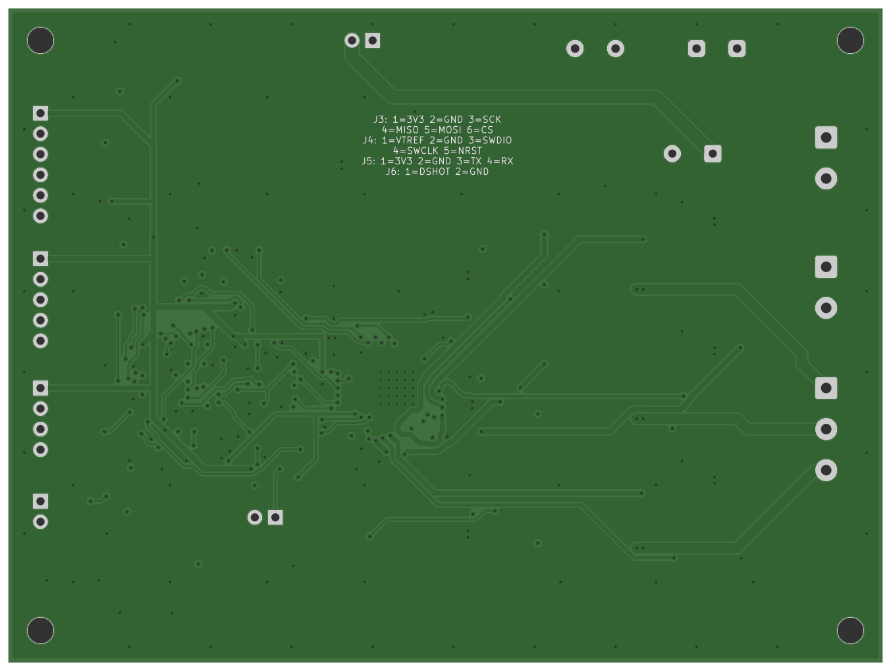

# Основная плата

Плата управления одним бесколлекторным мотором: STM32G431, драйвер DRV8323RS,
трёхфазный мост на шести MOSFET и три шунта для измерения токов. Всё, что нужно
мерить на стенде, выведено на контрольные площадки.

*3D-вид из KiCad. Шунты R30-R32 показаны без 3D-модели.*

*Нижняя сторона по Gerber-файлам: распиновка разъёмов на шелкографии.*

## Коротко

| Параметр | Значение |
|---|---|
| Размер | 108 × 81 мм, 4 слоя, FR-4 1,6 мм |
| Компоненты | 149 позиций, из них 109 устанавливаются, 36 контрольных площадок и 4 отверстия M3 |
| Трассировка | 2598 сегментов дорожек, 300 переходных отверстий, земля на всех четырёх слоях |
| Питание | 12 В номинально, рабочий диапазон 9-16 В |
| Ток фазы на первых запусках | до 1 А (ограничение в прошивке и на блоке питания) |
| Измерение тока | шунты 20 мОм, усиление 40, 0,8 В/А, линейный диапазон около ±1,75 А |
| ШИМ | 48 кГц, TIM1, центрированный, dead-time около 400 нс |

## Схема по листам

| Лист | Что на нём |
|---|---|
| 01 Power | вход, предохранитель 2 А, защита от переполюсовки, понижающий преобразователь 5 В, LDO 3,3 В |
| 02 MCU | STM32G431CBT6 в LQFP48, развязка питания, BOOT0, RESET, светодиоды |
| 03 Driver | DRV8323RS, зарядовый насос, SPI, ENABLE, nFAULT, фильтры АЦП |
| 04 Inverter | шесть MOSFET PSMN7R0-60YS, затворные резисторы, три четырёхвыводных шунта |
| 05 Interfaces | мотор, энкодер, SWD, UART, DShot, делитель напряжения шины, термистор |
| 06 Testpoints | 36 контрольных площадок и четыре крепёжных отверстия |

Назначение выводов STM32 описано в [плане выводов](../../docs/pin-plan.md),
конфигурация периферии лежит в [`cubemx/CubeMX.ioc`](cubemx/CubeMX.ioc).

## Как устроено питание

`J1 → F1 → Q7 → VIN_PROTECTED`: вход через предохранитель 2 А и P-MOSFET от переполюсовки.
От `VIN_PROTECTED` работает понижающий преобразователь DRV8323 (5 В) и дальше LDO AP2112
(3,3 В для STM32 и энкодера).

- **JP1** подключает `VIN_PROTECTED` к шине `VM`, то есть к мосту и питанию драйвера.
  С открытой JP1 можно спокойно проверить питание логики и прошить МК.
- **JP2** разрешает управлять ENABLE драйвера с МК. Без перемычки резистор R14 держит
  ENABLE в нуле.
- **SW2** отключает драйвер, пока кнопка нажата. Это не защёлка: после отпускания
  прошивка не должна включаться сама.
- **nFAULT** драйвера заведён на PA12 и на вход BKIN таймера TIM1, чтобы ШИМ выключался
  аппаратно.
- **J7** выводит шину `VM` для внешней нагрузки при опытах с торможением. TVS-диод
  SMBJ18A гасит только короткие выбросы и не рассчитан на энергию торможения.

## Разъёмы

| Разъём | Назначение |
|---|---|
| J1 | питание 12 В |
| J2 | фазы мотора A, B, C |
| J3 | энкодер: 3,3 В, GND, SCK, MISO, MOSI, CS |
| J4 | SWD: VTREF, GND, SWDIO, SWCLK, NRST |
| J5 | UART: 3,3 В, GND, TX, RX |
| J6 | DShot и GND |
| J7 | шина VM для внешней нагрузки |

Все сигналы 3,3 В. Контакты питания на разъёмах - выход платы или VTREF, а не вход.

## Контрольные площадки

| Площадки | Что на них |
|---|---|
| TP1-TP3 | GND |
| TP4, TP5 | VIN_PROTECTED и VM, до и после JP1 |
| TP6, TP7, TP8 | 5 В, 3,3 В и аналоговые 3,3 В |
| TP9-TP12 | ENABLE, nFAULT, сигнал замера времени цикла, MISO |
| TP13-TP18 | шесть сигналов ШИМ от STM32 |
| TP19, TP20, TP21 | сигналы токов фаз A, B, C на входах АЦП |
| TP22, TP23 | напряжение шины и температура |
| TP24 | внутреннее питание DVDD драйвера |
| TP25-TP36 | затвор и исток верхнего и нижнего ключа каждой фазы |

Землю обычного осциллографа подключать только к GND, а не к фазе или истоку верхнего
ключа. Для таких точек нужен дифференциальный щуп.

## Файлы

- [`kicad/`](kicad/) - проект KiCad 10: схема, плата и библиотеки проекта. Открывать
  `foc-dev-board.kicad_pro`, копировать нужно всю папку.
- [`documentation/SCHEMATIC.pdf`](documentation/SCHEMATIC.pdf) - схема, 7 листов.
- [`documentation/ASSEMBLY.pdf`](documentation/ASSEMBLY.pdf) - сборочный чертёж, верхняя сторона.
- [`manufacturing/`](manufacturing/) - Gerber, сверловка, перечень компонентов и координаты.
- [`mechanical/foc-dev-board.step`](mechanical/foc-dev-board.step) - 3D-модель платы с компонентами.
- [`cubemx/`](cubemx/) - конфигурация STM32CubeMX и отчёт по ней.

## Что проверить на собранной плате

Проверки ERC и DRC в KiCad проходят без ошибок, но это проверка файлов, а не работы платы.
Перед запуском мотора нужно:

1. **Ток и защиту.** Предел 1 А задаётся прошивкой и блоком питания. Минимальный порог
   защиты DRV8323 (0,25 В на шунте) с шунтом 20 мОм соответствует 12,5 А, поэтому он не
   заменяет программный предел. Предохранитель 2 А стоит на входе и фазный ток не ограничивает.
2. **Окно АЦП.** Ток A и C измеряет ADC1, ток B - ADC2, это не одновременная выборка.
   При скважности 97% нижний ключ открыт всего 625 нс, а dead-time 400 нс плюс
   установление усилителя (при усилении 40 по документации около 1,2 мкс) туда не
   помещаются. Окно выборки и предел скважности нужно проверить осциллографом.
3. **Включение и аварийное отключение.** Запрет самозапуска, ручное повторное включение
   после аварии, работа BKIN и поведение при остановке отладчиком.
4. **Коммутацию.** Начать с умеренного тока затворов DRV8323, проверить напряжение на
   затворах, звон и отсутствие сквозного тока.
5. **Нагрев.** LDO AP2112 при 150 мА рассеивает около 0,25 Вт, ключи и шунты проверить
   термопарой на реальном токе.

Пошаговый порядок описан в [памятке по сборке и первому включению](bring-up.md).
