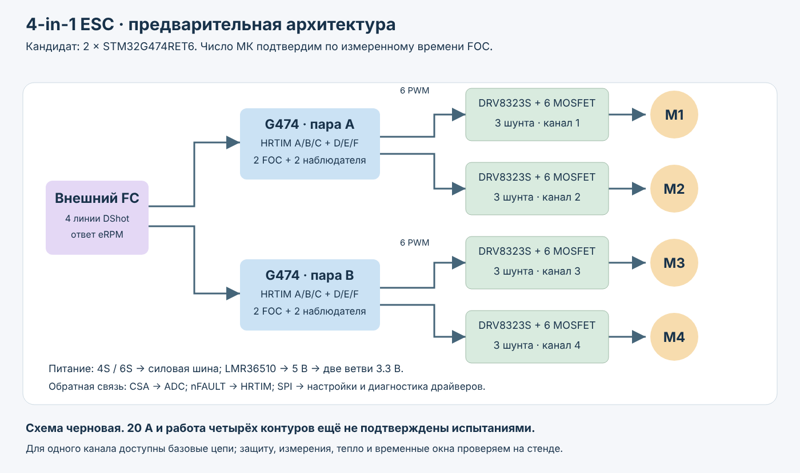
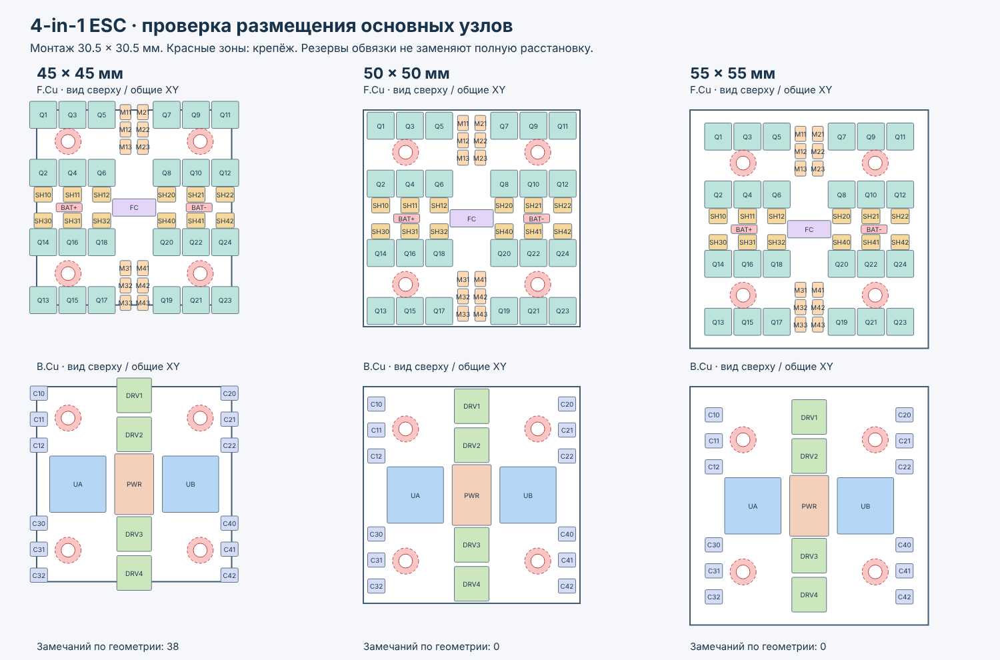

# 4-in-1 ESC: черновик

Четырёхканальный регулятор для квадрокоптера, следующий шаг после стенда. Сейчас это
инженерная проработка: схема в KiCad и проверка размещения основных узлов. Это не
комплект для производства: Gerber из этих файлов не делать, детали по ним не заказывать.

## Что задумано

- Четыре мотора, внешний покупной полётный контроллер, команды по DShot и
  телеметрия обратно.
- Питание 4S (16,8 В заряженный аккумулятор), с запасом на 6S (25,2 В).
- Рабочая гипотеза: два STM32G474RET6 (LQFP64), каждый управляет двумя DRV8323S и
  двумя трёхфазными мостами через HRTIM. Для сравнения остаётся базовый вариант
  с четырьмя STM32G431, по одному на мотор.
- ШИМ 48 кГц.

## Сколько микроконтроллеров

| Вариант | Ресурсы на МК | Плюсы | Минусы |
|---|---|---|---|
| 4 × G431 или G474, по мотору | 6 ШИМ, 3 входа тока, один наблюдатель | простая отладка, запас по времени | четыре МК с обвязкой |
| 2 × G474RET6, по два мотора | 12 выходов HRTIM, 6 входов тока, два наблюдателя | меньше МК, одинаковые таймеры | очередь АЦП, расписание двух моторов |
| 1 × G474 на четыре мотора | 24 ШИМ, 12 входов тока | один МК и программатор | жёсткий бюджет времени, большой корпус, разные таймеры |

Время на мотор считается так: `170 МГц / (48 кГц × моторов на МК)`. С запасом 30% на
быстрый контур остаётся:

| Моторов на МК | Период обслуживания | Тактов на мотор | С запасом 30% |
|---:|---:|---:|---:|
| 1 | 20,8 мкс | 3542 | 2479 |
| 2 | 10,4 мкс | 1771 | 1240 |
| 4 | 5,2 мкс | 885 | 620 |

В быстрый контур входят чтение токов, FOC, наблюдатель, ограничители, обновление
регистров ШИМ и очередь АЦП. Решение о числе МК принимается после замера времени
шага FOC на основной плате, а не по таблице.

## Силовая часть: кандидаты

- **Ключи:** BSC028N06NS, 60 В, 2,8 мОм, 24 штуки.
- **Шунты:** WSKW06121L000FEA, 1 мОм, 1 Вт, четыре вывода, 12 штук. При усилении 40
  линейный диапазон около ±35 А.
- **Питание логики:** понижающий LMR36510ADDAR на 5 В и две ветви 3,3 В на AP2112K
  (одна на пару моторов).
- **Шина:** внешний электролит 470-1000 мкФ на 63 В, керамика у каждого полумоста,
  TVS SMBJ30A как кандидат.

Цифра «20 А на канал» пока не подтверждена. Для расчёта она разделена: 20 А RMS по
фазе - это 28,3 А в пике, а ток аккумулятора зависит от нагрузки, оборотов и КПД.
При 20 А RMS проводимость одного моста около 5,7 Вт (с поправкой на нагрев ключей).

## Что есть в KiCad

- Схема: 13 листов, 234 компонента, 242 цепи. ERC KiCad без ошибок и предупреждений.
- Для двух моторов на один G474 найдено распределение выводов: 12 выходов HRTIM,
  SPI, два входа DShot, SWD и два аппаратных входа аварии.
- `placement-study.kicad_pcb` - макет без цепей и дорожек. В нём настоящие
  посадочные места 24 ключей, двух LQFP64, 12 конденсаторов и четырёх отверстий,
  остальные узлы показаны габаритными зонами.

При одной и той же расстановке квадрат 45 × 45 мм даёт 38 пересечений габаритов,
50 × 50 и 55 × 55 мм проходят без пересечений. Крепление 30,5 × 30,5 мм. Это
проверка площади, а не готовая геометрия полумоста: верхний и нижний ключи в макете
стоят далеко друг от друга, мелкой обвязки и трассировки нет.

## Что ещё не решено

Число МК, допустимый непрерывный ток, частота FOC на максимальных оборотах,
окончательные ключи и шунты, реальная ёмкость керамики под напряжением, номиналы
фильтров, пороги защит, тепловой режим, размер платы, стек слоёв и кабель к
полётному контроллеру.

## Что измерить до финальной платы

На основной плате и стенде:

- безопасное поведение при сбросе и аварии драйвера, полярность и dead-time ШИМ;
- минимальное окно, в котором ток измеряется достоверно;
- параметры мотора и эталон угла от энкодера для наблюдателя;
- худшее время быстрого контура вместе с наблюдателем, DShot и телеметрией, по
  счётчику DWT и выводу на осциллограф. Цель: не больше 70% доступного окна и ни
  одного пропуска в длительном прогоне.

Потом отдельный одноканальный прототип на большой ток: напряжения на ключах, звон,
ложные включения, нагрев ключей, шунтов и меди, защита от перегрузки, торможение с
поглотителем энергии. Вращение мотора без нагрузки не подтверждает 20 А на 6S.

## Файлы

- [`kicad/`](kicad/) - проект KiCad 10: `esc-4in1.kicad_pro`, схема из 13 листов и
  макет размещения `placement-study.kicad_pcb`.
- [`documentation/SCHEMATIC.pdf`](documentation/SCHEMATIC.pdf) - схема для просмотра.
