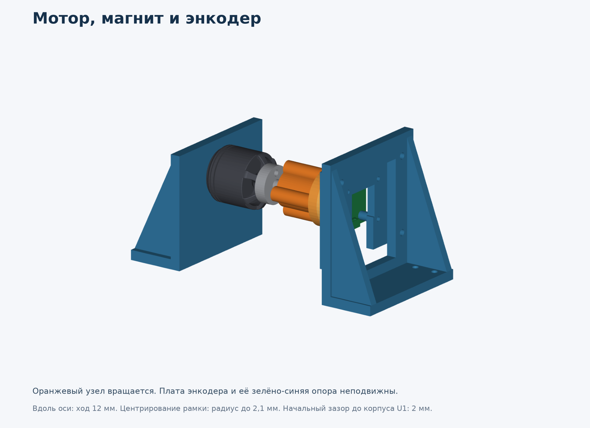
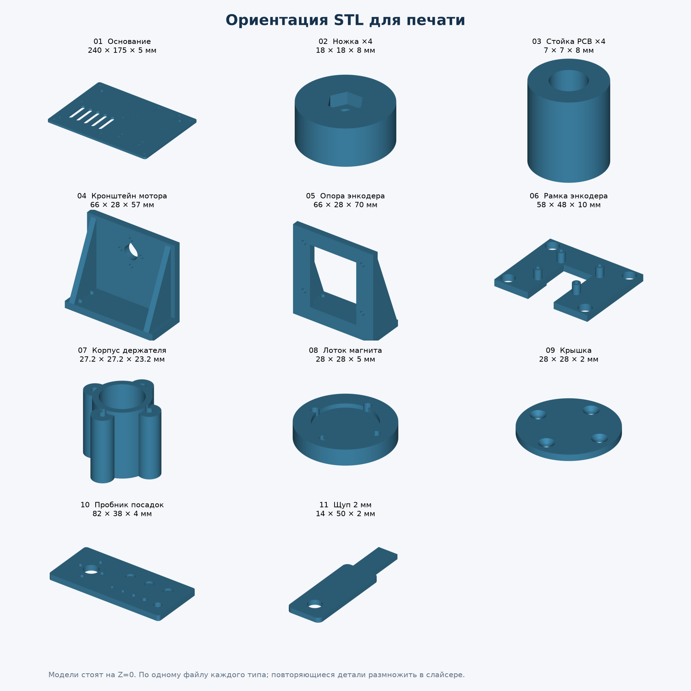

# Испытательный стенд

Печатный стенд для одного мотора: на общем основании стоят мотор T-Motor MN2212 V2.0
KV920, основная плата и плата энкодера. Магнит закреплён на роторе и вращается
вместе с ним, плата энкодера неподвижна. Материал - обычный PETG, все размеры в
миллиметрах. Стенд рассчитан на работу без пропеллера.

Стенд пока существует только в CAD: он ещё не напечатан и не собран. Допустимые
обороты и нагрев механики не проверялись.

## Файлы

- [`stl/`](stl/) - 11 моделей для печати. Каждая уже повёрнута как надо и стоит на
  Z = 0. Масштаб в слайсере 100%, единицы мм.
- [`step/`](step/) - те же детали отдельными телами для правки, и общая сборка
  `stand-assembly.step` с мотором и моделями плат. Сборку в слайсер не загружать.
- [`print-layout.pdf`](print-layout.pdf) - лист всех деталей с размерами.
- [`assembly.md`](assembly.md) - крепёж и порядок сборки.
- [`fasteners.csv`](fasteners.csv) - перечень крепежа на один стенд.

## Что печатать

| Файл | Деталь | Количество |
|---|---|---:|
| `01_base` | основание 240 × 175 × 5 мм с окнами и прорезями для стяжек | 1 |
| `02_foot` | ножка высотой 8 мм, сверху гнездо под гайку M3 | 4 |
| `03_pcb_spacer` | стойка основной платы высотой 8 мм, наружный Ø7 | 4 |
| `04_motor_bracket` | кронштейн мотора, монтажная стенка 5 мм | 1 |
| `05_encoder_slide` | опора энкодера с регулировкой зазора вдоль оси | 1 |
| `06_encoder_frame` | рамка платы энкодера, четыре стойки Ø4,5 × 6, регулировка центровки | 1 |
| `07_magnet_cup` | корпус держателя магнита под штатный адаптер M5 и две тонкие гайки | 1 |
| `08_magnet_tray` | лоток под магнит Ø6 × 2,5, карман Ø6,2 × 1,4, центрирующая посадка | 1 |
| `09_magnet_lid` | крышка 2 мм с четырьмя потайными отверстиями M2, над магнитом 0,8 мм пластика | 1 |
| `10_fit_coupon` | пробник отверстий мотора, магнита и крепежа | 1 |
| `11_gap_gauge_2mm` | щуп начального зазора, перед вращением убрать | 1 |

Всего 15 деталей стенда, плюс пробник и щуп: 17 штук. Мотор, магнит, адаптер,
крепёж и платы покупаются отдельно.

## Первая печать

1. Начать с пробника `10_fit_coupon`, потом рамка `06` и детали держателя `07`-`09`.
   Проверить отверстия, гнёзда гаек, посадку магнита и адаптера. На пробнике
   три кармана под магнит Ø6,1 / 6,2 / 6,3 мм идут слева направо, если группа
   отверстий мотора слева. Нижний ряд отверстий: Ø2,2 / 2,4 / 2,8 / 3,4 / 5,3 мм.
2. Основание и кронштейны печатать после примерки. Посадки не исправлять
   масштабом всей модели, только диаметрами и зазорами в модели.
3. Стартовый профиль для сопла 0,4 мм: слой 0,2 мм, 5 периметров, по 6 верхних и
   нижних слоёв. Основание и кронштейны 35-40% заполнения, стойки, ножки, рамка,
   детали `07`-`09` и щуп 100%. Это отправная точка, а не проверенный профиль.
4. Лоток `08` лежит в STL карманом магнита к столу. Над карманом получается мост
   около 6,2 мм, мосты поменьше есть над выемкой крышки, гнёздами гаек и
   отверстиями в кронштейнах. Если мосты получаются плохо, включить локальные
   поддержки и после печати проверить плоское дно кармана.
5. Температуру, обдув и скорость брать из профиля купленного PETG и проверять на
   пробнике. Если углы отрываются, добавить кайму. Самая большая деталь - основание
   240 × 175 мм.

После печати снять наплывы первого слоя и проверить штангенциркулем плоскости и
размеры щупа. Важнее всего соосность отверстия M5 и кармана магнита, посадка гаек и
плоскость рамки. Печатный щуп не является точной мерой.

## Что проверить на реальном комплекте

- **Длину винтов мотора.** На чертеже MN2212 не указана допустимая глубина
  резьбы M2,5, поэтому длина винтов не выбрана. Как посчитать, описано в
  [инструкции по сборке](assembly.md).
- **Адаптер M5.** Нужен штатный болтовой адаптер с наружной резьбой M5, буртиком
  Ø5,7 и резьбовой частью 13 мм, как на чертеже. Цанговый адаптер другой формы не подойдёт.
- **Магнит.** Заложен Ø6 × 2,5 мм, намагниченный по диаметру, артикул ещё не выбран.
  2 мм - это начальный зазор между крышкой и корпусом датчика, а не рабочий
  магнитный зазор. Между магнитом и датчиком ещё 0,8 мм пластика и около 0,1 мм
  зазора внутри крышки.
- **Клей.** Магнит нужно приклеить к лотку, иначе круглый магнит может
  проворачиваться. Клей подобрать под PETG и покрытие магнита и проверить на образце.
- **Биение и нагрев.** Проверить биение держателя, затяжку, нагрев и диагностику
  AS5047P. Люфт на резьбе M5 исправляется подгонкой отверстия по пробнику, а не
  смещением рамки.

## Что проверено в CAD

- Все STL замкнуты, каждая модель - одно тело с правильной ориентацией граней,
  стоит на Z = 0.
- В номинальном положении печатные детали не пересекаются друг с другом, с мотором,
  платами, магнитом, шайбой и гайками M5.
- За разъёмом платы энкодера оставлено место: 16 мм по ширине, 6 мм за платой и
  15 мм под платой для выхода кабеля.

Не все положения регулировок безопасны: пазы позволяют придвинуть плату до касания.
Зазор выставляется без питания, по щупу и с проворотом мотора рукой. Провода и
весь металлический крепёж в сборке не показаны.

Модель мотора взята из заводского STEP: монтажная плоскость и передний торец
отстоят на 26,5 мм, диаметр 27,5 мм, длина по концам вала 32,5 мм (на чертеже
32,6 мм). Совпадение модели с конкретной поставкой V2.0 нужно проверить. Адаптера
в заводском STEP нет, его упрощённая модель построена по чертежу.

## Источники размеров

- [T-Motor MN2212 V2.0](https://store.tmotor.com/cn/product/mn2212-v2-motor-navigator-type.html),
  [чертёж PDF](https://cn.tmotor.com/uploadfile/downloads/tmotor-mn2212-motor-2d-drawings.pdf),
  [модель STEP](https://cn.tmotor.com/uploadfile/downloads/tmotor-mn2212-motor-3d-model.step).
- [Механика платы энкодера](../encoder-board/README.md#механика).
- [Тонкая латунная гайка M5, DIN 439B, высота 2,7 мм](https://www.aspenfasteners.com/m5-0-8-din-439b-metric-thin-hex-jam-nuts-brass/).
- [Латунная шайба M5, DIN 125](https://eshop.wuerth.de/Flat-washer-For-hexagon-head-bolts-and-nuts-DIN-125-plain-brass-WSH-DIN125-A-BRS-D53/04005.sku/en/US/EUR/).
